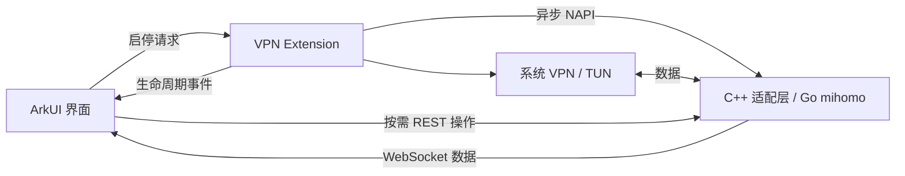

# Clash Harmony

面向 HarmonyOS 的 Clash / mihomo 代理客户端，使用 ArkTS + ArkUI 原生界面，通过 VPN Extension 接入 Go 内核。当前主要在 ARM64 鸿蒙手机上开发和验证。

本项目由 [LiMoRan123/clash-harmony](https://github.com/LiMoRan123/clash-harmony) 独立维护，源自 [andycaihello/clash-harmony](https://github.com/andycaihello/clash-harmony)，保留原始提交历史、来源说明和 GPL-3.0-only 许可证。界面布局参考 FlClash 0.9.x，当前功能以本文和实际实现为准。

> 当前应用版本为 `0.1.0`，功能说明更新于 **2026-10-29**。`release/` 安装包和 `docs/screenshots/` 截图属于早期版本，不代表当前界面与功能；体验当前版本请从源码构建。

## 功能

应用采用「仪表盘 / 代理 / 配置 / 工具」四个页面，支持跟随系统、浅色和深色主题。

| 页面 | 已实现能力 |
| --- | --- |
| 仪表盘 | VPN 启停与阶段反馈、运行时长、活跃连接数、实时上传/下载速度与趋势、规则/全局/直连模式、当前配置与代理策略、手动查询出口 IP |
| 代理 | 策略组与节点选择、搜索、原顺序/名称/延迟排序、单列/双列布局、同步运行中的策略组、节点延迟测试及进度 |
| 配置 | 订阅链接、剪贴板及本地文件导入，单个/批量更新，加载动画、逐项结果与失败重试，启用、编辑、导出和删除 |
| 工具 | 活跃连接、分流规则、DNS 配置、应用运行日志及导出，外观、网络和延迟测试设置，完整备份与恢复、关于信息 |

### 订阅与配置

- 支持 Clash / mihomo YAML，以及可解析的 Base64 包装内容；可转换 Shadowsocks 通用订阅。
- 支持响应内容规范化与校验，更新失败时保留已有配置；更新正在使用的配置后，重新连接使新配置生效。
- 配置页展示服务商返回的已用、总量、剩余流量与到期信息，数据随订阅更新并保存到本地。
- 流量与到期信息依赖服务商的 `Subscription-Userinfo` 响应头。未提供时显示相应提示；这里是账号累计统计，与仪表盘的本机实时流量不同。
- 备份包含配置内容、订阅信息和应用偏好；恢复前需断开 VPN，并在界面确认。

节点测试测量的是延迟，不是下载带宽。`REJECT` 是拦截策略，不作为普通节点测速。

### 运行状态与通信

- 连接状态与实时流量分别维护，减少高频数据更新对整页的影响。
- VPN Extension 通过系统事件反馈启动、运行、停止等阶段，界面不再等待首页定时请求才更新状态。
- 运行数据使用 mihomo WebSocket 连接快照推送，替代首页 HTTP 定时轮询；订阅下载、策略操作、启动探测和恢复状态仍按需使用 HTTP。
- 原生内核启停通过异步 NAPI 工作任务执行，避免在界面线程同步等待 Go 内核。
- 接入后台数据传输任务、会话核对和停止确认，并记录任务取消及运行异常，方便排查后台断开。

实现与验证范围见 [状态推送与性能](doc/runtime-push-and-performance.md)、[后台运行](doc/background-stability.md) 和 [停止流程](doc/vpn-disconnect.md)。

## 开始使用

### 开发环境

- DevEco Studio、HarmonyOS SDK 及其配套 Node.js、JBR 和 Native 工具链。
- 当前工程配置为 HarmonyOS `5.0.0(12)`；实际能否安装还取决于设备系统、SDK 与签名配置。
- ARM64 真机用于实际 VPN 验证。`x86_64` 使用 fake/stub adapter，主要用于界面和构建验证。
- 本机配置 DevEco 签名，并将测试设备加入对应调试配置。

获取代码：

```bash
git clone https://github.com/LiMoRan123/clash-harmony.git
cd clash-harmony
git switch dev
```

在 DevEco 中打开工程，完成依赖同步和签名配置，选择手机后使用 **Run（▶）** 安装。验证日常连接时，建议从手机桌面启动应用；Native Debug 曾出现 Go `SIGURG` 信号使调试器暂停线程的情况，详见 [启动与调试记录](doc/startup-and-performance.md)。

首次使用：

1. 在「配置」页添加订阅，或通过剪贴板、本地文件导入配置。
2. 更新订阅并启用配置，在「代理」页选择策略或节点；按需点击测速图标。
3. 回到「仪表盘」点击连接，按系统提示允许 VPN。
4. 在「工具」查看连接和日志；网络设置、当前配置内容等运行参数修改后，重新连接生效。

### 命令行构建

以下为当前 macOS 开发环境使用的路径，其他安装位置需相应调整：

```bash
env NODE_HOME=/Applications/DevEco-Studio.app/Contents/tools/node \
  JAVA_HOME=/Applications/DevEco-Studio.app/Contents/jbr/Contents/Home \
  DEVECO_SDK_HOME=/Applications/DevEco-Studio.app/Contents/sdk \
  /Applications/DevEco-Studio.app/Contents/tools/hvigor/bin/hvigorw \
  assembleHap --mode module -p module=entry@default -p product=default \
  -p buildMode=debug --no-daemon
```

配置有效签名后，生成的安装包位于：

```text
entry/build/default/outputs/default/entry-default-signed.hap
```

调试签名与设备授权有关，仓库内历史签名包不能保证安装到其他设备。本机签名材料、密码与个人订阅不要提交到仓库。

### 使用 HDC 安装

先在手机开启开发者调试并完成 USB 授权，查看设备：

```bash
HDC=/Applications/DevEco-Studio.app/Contents/sdk/default/openharmony/toolchains/hdc
"$HDC" list targets
```

将下面的 `your-device-serial` 替换为实际设备序列号，使用本次构建的包安装：

```bash
HAP=entry/build/default/outputs/default/entry-default-signed.hap \
  bash release/install-to-device.sh your-device-serial
```

脚本默认的 HDC 路径与上面一致，其他路径可通过环境变量 `HDC` 指定。**这里必须显式指定 `HAP`**，因为该历史脚本的默认包仍是 `release/` 中的旧版本。

## 技术结构



| 目录 | 内容 |
| --- | --- |
| `entry/src/main/ets/pages/`、`components/` | 页面与可复用 ArkUI 组件 |
| `entry/src/main/ets/models/`、`services/` | 界面状态、订阅、配置、运行通信与备份 |
| `entry/src/main/ets/vpnextensionability/` | 系统 VPN 扩展与生命周期 |
| `entry/src/main/ets/preview/` | DevEco 组件预览样例，不接入实际 VPN |
| `entry/src/main/cpp/` | NAPI、内核适配、TUN 和 socket 保护 |
| `entry/src/main/cpp/prebuilt/arm64-v8a/` | 当前使用的 Go 内核预编译库与执行 fallback |
| `tests/` | 行为回归、原生桥接、打包和真机检查脚本 |
| `doc/` | 当前改造、问题修复和维护记录 |
| `docs/` | 早期设计、原型与历史截图 |

真机包名为 `io.github.clashharmony.app`，入口为 `EntryAbility`，VPN 扩展为 `ClashVpnExtensionAbility`。

## 验证

在仓库根目录运行行为与原生桥接回归：

```bash
for task_test in tests/*.test.mjs; do
  node "$task_test" || exit 1
done
```

这些测试需要 Node.js；部分 ArkTS 服务测试依赖 DevEco SDK 内的 TypeScript，原生测试需要 C++ 编译器及 Node-API 头文件。SDK 安装位置不同时可设置 `ARKTS_TYPESCRIPT_PATH`，Node 头文件位置可设置 `NODE_INCLUDE_DIR`。

构建后校验 ARM64 安装包内容与内核打包：

```bash
node tests/verify-hap-contents.mjs \
  entry/build/default/outputs/default/entry-default-signed.hap \
  --require-abi arm64-v8a --evidence-dir artifacts/hap-check
node tests/verify-mihomo-prebuilt-packaging.mjs --require-abi arm64-v8a
```

安装并从桌面打开应用后，可运行以下真机检查；在 45 秒观察期间手动连接 VPN，脚本采集启动日志和 controller 状态。这里跳过重复安装与启动，多台设备连接时另加 `--serial` 指定目标：

```bash
HDC=/Applications/DevEco-Studio.app/Contents/sdk/default/openharmony/toolchains/hdc \
  node tests/verify-device-mihomo.mjs \
  --no-install --no-launch --observe-ms 45000 \
  --evidence-dir artifacts/mihomo-device
```

2026-10-29 的功能整理已通过 11 组 `*.test.mjs` 回归、HarmonyOS debug 签名构建、ARM64 HAP 内容和内核打包检查。用户真机反馈已验证订阅更新、显示节点及基本 VPN 访问；这些结果不代表所有设备兼容性、长期后台稳定性或耗电均已验证。

## 当前边界

- 优先使用服务商提供的 Clash / mihomo YAML。原始 URI 订阅转换目前主要覆盖 Shadowsocks，不能把所有 VMess、VLESS、Trojan 等 URI 列表直接当作已支持；YAML 内的协议支持由当前内核决定。
- 当前系统 TUN 配置以 IPv4 为主，界面中的 IPv6 配置项不代表已完成 IPv6 VPN 全链路支持。
- 后台存活仍受系统策略、用户清理和任务取消影响，长时间运行、待机耗电及更多机型适配仍需真机测试。
- 「运行日志」记录应用的连接、订阅、测速与生命周期事件，尚未接入完整 mihomo 实时日志流。
- 尚未实现分应用代理、二维码导入、WebDAV 同步等完整客户端功能；当前也未发布应用市场版本。
- 当前内核使用仓库中的预编译产物。对应源码版本与可复现构建流程仍需补齐，现阶段未重新编译、裁剪或升级 Go 内核；产物来源记录见 [第三方声明](THIRD_PARTY_NOTICES.md)。

## 说明文档

| 文档 | 内容 |
| --- | --- |
| [独立维护与分支约定](doc/independent-maintenance.md) | 仓库来源、解绑记录与 dev / main 工作流 |
| [界面改造](doc/ui-redesign.md)、[界面细化](doc/ui-polish.md) | 原生页面、加载反馈、图标测速和配置页布局 |
| [订阅兼容](doc/subscription-compatibility.md) | 订阅格式、解析和导入修复 |
| [订阅流量与到期](doc/subscription-info.md) | 账号统计来源、缓存、展示与验证 |
| [状态推送与性能](doc/runtime-push-and-performance.md) | 状态拆分、生命周期事件、WebSocket 与异步 NAPI |
| [后台运行](doc/background-stability.md)、[停止流程](doc/vpn-disconnect.md) | 后台任务、停止确认及排查边界 |
| [启动与调试](doc/startup-and-performance.md) | 启动耗时与 Native Debug 排查记录 |
| [原始工程分析](doc/project-analysis.md) | 改造前的工程基线，历史结论需结合后续记录阅读 |

## 维护与许可

`dev` 用于日常开发，`main` 保存通过验证的版本。上游项目作为来源和按需修复参考，不自动跟随或定期整仓合并。分支操作见 [独立维护说明](doc/independent-maintenance.md)。

项目遵循 [GPL-3.0-only](LICENSE)，第三方组件及预编译库说明见 [THIRD_PARTY_NOTICES.md](THIRD_PARTY_NOTICES.md)。独立维护保留原项目与各贡献者的历史和署名。Clash Harmony 不提供代理节点、订阅账号或订阅服务。
