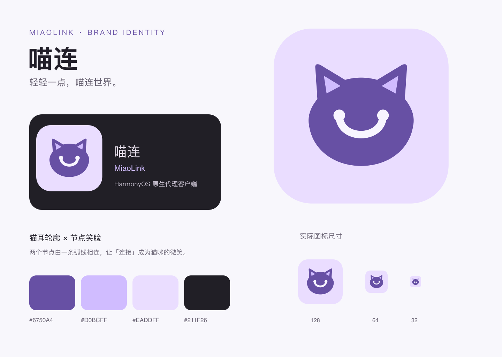

# 喵连 · MiaoLink 品牌与应用名称

日期：2026-10-29。开发分支：`dev`。

产品中文名为 **喵连**，英文名为 **MiaoLink**。这是基于 Clash Harmony 独立维护的 HarmonyOS 原生代理客户端，名称由用户选定。

## 图形与色彩

标志采用猫耳轮廓；猫脸中的两个圆点代表连接节点，弧线将它们连接成微笑。延续应用的浅紫色系，使用平面矢量图形，保持小尺寸下的识别度。



| 色彩 | 色值 | 用途 |
| --- | --- | --- |
| 主紫 | `#6750A4` | 主标志，与现有浅色主题主色一致 |
| 浅紫 | `#D0BCFF` | 耳部细节、深色背景版本，与深色主题主色一致 |
| 淡紫底 | `#EADDFF` | 应用图标背景 |
| 奶白 | `#F8F5FF` | 连接节点和弧线 |
| 深底 | `#211F26` | 深色场景预览，与深色主题卡片底色一致 |

## 资源

| 文件 | 用途 |
| --- | --- |
| [miaolink-icon.svg](../assets/brand/miaolink-icon.svg) | 512×512 完整应用图标主文件 |
| [miaolink-icon.png](../assets/brand/miaolink-icon.png) | 同一矢量图标导出的 512×512 PNG |
| [miaolink-mark.svg](../assets/brand/miaolink-mark.svg) | 透明背景标志，用于浅色背景 |
| [miaolink-mark-light.svg](../assets/brand/miaolink-mark-light.svg) | 用于深色背景的浅色标志 |
| [miaolink-logo.svg](../assets/brand/miaolink-logo.svg)、[PNG](../assets/brand/miaolink-logo.png) | 图标加中英文名称的横向组合 |
| [品牌展示板 SVG](../assets/brand/miaolink-brand-board.svg)、[PNG](../assets/brand/miaolink-brand-board.png) | 配色、明暗场景和 128/64/32px 尺寸预览 |

源码中的两份 `app_icon.svg` 均由 `miaolink-icon.svg` 同步，分别用于 AppScope 与 entry 资源。后续修改主图标后需同步这两份文件，保持桌面图标和启动图标一致。

图标保持等比缩放，不添加拉伸、阴影或额外渐变。完整应用图标建议至少 32px；横向组合建议至少 240px。透明标志用于品牌展示时，周围留出至少一个标志高度的空白；系统应用图标使用主文件中已有的安全边距，由系统按设备形状裁切。横向组合中的文字使用系统无衬线字体，未嵌入字体文件。

本轮直接绘制 SVG，并使用 `rsvg-convert` 导出展示 PNG，未使用生成式位图作为应用图标。品牌图形随本仓库许可证提供。

## 应用接入与兼容

- 桌面与系统应用名统一为「喵连」；关于页显示「喵连 / MiaoLink」、新 Logo、版本和当前源码仓库。
- 启动窗口、桌面和应用内关于页使用同一图标；VPN 传输通知显示「喵连 VPN」。
- 导出文件使用 `miaolink.log` 与 `miaolink-backup.json`；恢复入口仍支持旧版本备份。
- 应用包名沿用 `io.github.clashharmony.app`，签名使用现有本机配置，便于覆盖安装和保留配置。
- 备份内部的 `clash-harmony` 格式标记、已有存储名称、日志标签及订阅 User-Agent 兼容标识保持原值，避免改名影响数据或订阅识别。
- 代码仓库地址继续为 `LiMoRan123/clash-harmony`；保留原作者来源、Git 历史、GPL-3.0-only 和第三方组件说明。

对外描述统一为「喵连 · MiaoLink，HarmonyOS 原生代理客户端」，并提供当前源码仓库地址。项目不提供订阅账号或代理节点。

## 验证

检查两份应用图标与主文件内容一致、名称资源与关于页/通知文案一致，并校验 SVG XML、PNG 尺寸和文档链接。已有关于订阅、备份恢复和后台任务的行为回归用于确认改名没有破坏兼容路径；本轮不新增仅重复文案的测试。

品牌展示板已渲染并查看，确认猫耳、连接节点、中文及英文可读。应用实际启动页和桌面图标仍需安装后的真机验收。

本轮 app-flow、后台生命周期、备份与 UI 工作流、首页状态共 4 组回归通过。HarmonyOS debug 签名构建耗时 15.689 秒，ARM64 HAP 内容及内核打包检查通过；直接读取 HAP 确认已打入新图标，编译资源包含「喵连」。

安装包：[entry-default-signed.hap](../entry/build/default/outputs/default/entry-default-signed.hap)。

```text
SHA256: 1eef0f7059f176b639c0c25e535530a38014d76e3381dec459b7ab38d8bba1e4
```

本轮测试、构建和打包证据位于被 Git 忽略的 `artifacts/brand/`。
