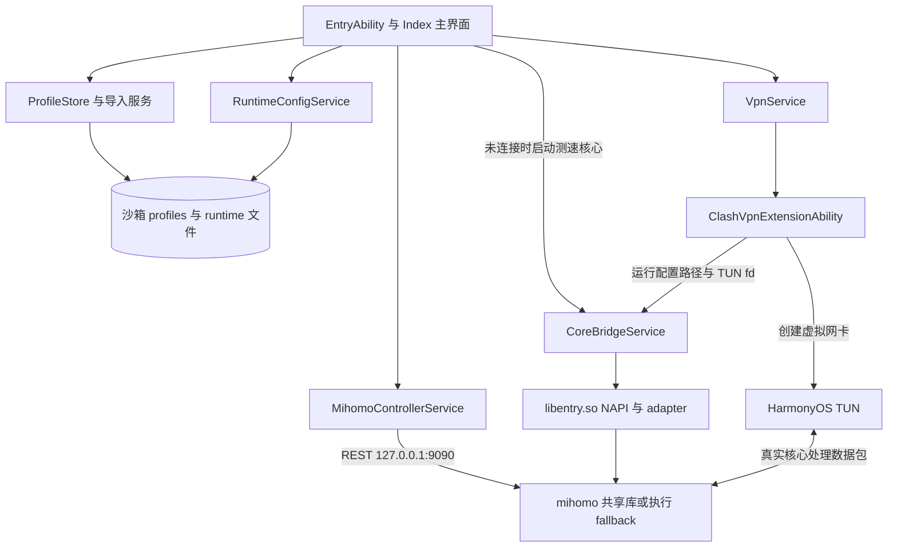
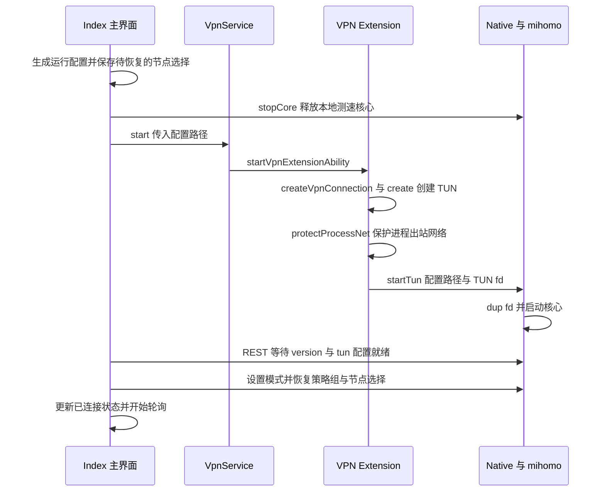

# Clash Harmony 项目研究说明

本文面向首次接手项目的开发者，说明项目做什么、代码如何协作、怎样构建和验证，以及继续开发时需要优先处理的问题。

本文以最初拉取的提交为研究基线。后续 `dev` 分支的修复见 [订阅兼容性修复记录](subscription-compatibility.md) 和 [核心启动与卡顿排查](startup-and-performance.md)。

整套界面的后续改造见 [FlClash 0.9.2 风格 UI 改造记录](ui-redesign.md)。本文下方仍描述最初拉取的基线结构。

启停进度、首页推送和后台 NAPI 的最新改造见 [运行状态推送与性能记录](runtime-push-and-performance.md)。

后台断开、长时任务及主动停止确认的后续处理见 [后台稳定性与关闭延迟](background-stability.md)。

当前页面布局、更新加载反馈及最新安装包见 [界面细化与更新反馈](ui-polish.md)。

后续新增 [订阅流量与到期信息](subscription-info.md)；当前安装包以该记录为准。仓库后续方向见 [独立维护建议](independent-maintenance.md)。

研究结论：项目已经具备订阅管理、节点测速、策略选择、VPN 启停和运行诊断的完整代码链路，适合作为 HarmonyOS 代理客户端的研究与二次开发基础。当前主流程依赖仓库内的 ARM64 mihomo 预编译产物；模拟器 fake adapter、未接入的增强服务和设置界面不能等同于完整产品能力。本文依据源码分析和文末列出的本机检查，不将仓库历史真机记录作为本次真机验证结果。

| 项目 | 本次研究基线 |
| --- | --- |
| 研究日期 | 2026-10-28 |
| 仓库 | [andycaihello/clash-harmony](https://github.com/andycaihello/clash-harmony) |
| 拉取地址 | `git@github.com:andycaihello/clash-harmony.git` |
| 分支 | `main` |
| 提交 | `c0994b2b0a3b972ed9946792f213697e97f66ae9` |
| 提交时间 | 2026-07-09 10:51:45 +08:00 |
| 应用标识 | `io.github.clashharmony.app` |
| 应用版本 | `0.1.0`，`versionCode = 1000000` |
| SDK 配置 | HarmonyOS `5.0.0(12)`，compatible 与 target 均为 API 12 |
| 技术栈 | ArkTS、ArkUI、Stage 模型、C++17、NAPI、mihomo 预编译核心 |
| 仓库声明的许可 | `GPL-3.0-only`，见 [LICENSE](../LICENSE) 和 [第三方声明](../THIRD_PARTY_NOTICES.md) |

## 1 项目定位与功能边界

应用负责导入用户自己的 Clash/mihomo 配置，在设备上启动代理核心，通过 HarmonyOS VPN Extension 接管系统 IPv4 流量。仓库没有提供代理节点、订阅账号或订阅服务。

当前底部导航由 [Index.ets](../entry/src/main/ets/pages/Index.ets) 中的 `NAV_ITEMS` 决定，共四项；顶部另有设置入口：

| 页面 | 当前主界面接入的功能 | 阅读时需要注意 |
| --- | --- | --- |
| 首页 | 连接与断开、规则/全局/直连模式、运行时长、上传下载速率、连接数、当前链路 | controller 可用与 VPN 已连接是两个不同状态 |
| 代理 | 节点列表与搜索、策略组同步、节点选择、全量延迟测试、测速结果与进度 | 当前测速走 mihomo controller；每批最多并发 12 个节点 |
| 配置 | 远程订阅、剪贴板与本地文件导入，启用、更新、删除配置 | URL 导入与实际下载分开；连接时会补下载尚无本地文件的订阅 |
| 诊断 | controller、native 状态、连接列表、规则与 DNS 查看、关闭全部连接、应用日志 | 界面日志来自应用记录；不能直接视为完整的 mihomo 日志流 |

以下内容虽然已有代码或设计稿，尚不能视为当前已完成的用户功能：

- `HomePage.ets`、`ProxyPage.ets`、`ProfilePage.ets`、`DiagnosticsPage.ets` 等独立页面没有被当前 `Index.ets` 引入，主界面仍使用 `Index.ets` 内联的界面构建方法。
- 顶部设置按钮实际打开 `Index.ets` 内的 `SettingsScreen()`，不是独立 `SettingsPage.ets`。其中“开关”由文本绘制，没有变更处理；DNS、备份等状态也有固定展示文本，不能视为已接入的设置能力。
- `EnhanceService`、`EnhanceStore`、`RuntimeConfigVersionService`、`BackupService` 和 `HealthMonitorService` 没有接入当前主界面连接流程。配置增强、版本回滚、备份与专用健康监控仍需要继续集成。
- 当前首页由 `Index.ets` 自己按秒轮询 controller；`TrafficPollerService` 保留在代码中，主流程会调用其 `stop()`，没有调用其 `start()`。

入口依据：[EntryAbility.ets](../entry/src/main/ets/entryability/EntryAbility.ets)、[main_pages.json](../entry/src/main/resources/base/profile/main_pages.json)、[Index.ets](../entry/src/main/ets/pages/Index.ets)。

## 2 目录与关键源码

```text
clash-harmony/
├── AppScope/                   应用标识、版本和应用资源
├── build-profile.json5         SDK、产品和本机签名配置
├── oh-package.json5            工程元数据，无第三方 ArkTS 依赖
├── hvigor/                     Hvigor 配置
├── entry/
│   ├── build-profile.json5     Stage 模型、CMake、C++17 和 ABI 配置
│   └── src/main/
│       ├── module.json5        UIAbility、VPN Extension 和权限声明
│       ├── ets/
│       │   ├── entryability/   应用入口
│       │   ├── pages/          Index 主界面与独立页面文件
│       │   ├── components/     可复用界面组件
│       │   ├── models/         配置和视图数据类型
│       │   ├── services/       订阅、运行配置、controller、VPN 等服务
│       │   └── vpnextensionability/
│       └── cpp/
│           ├── napi_init.cpp   ArkTS 与 native 的接口及状态
│           ├── mihomo_adapter.cpp
│           ├── tun_forwarder.cpp
│           ├── socket_protector.cpp
│           ├── health_monitor.cpp
│           ├── fake_mihomo/    简化 TCP adapter 源码
│           ├── prebuilt/      ARM64 核心库和执行 fallback
│           └── types/libentry/ NAPI 的 ArkTS 类型声明
├── tests/                      Node.js 检查与真机验收脚本
├── release/                    已跟踪的签名 HAP 和安装脚本
├── docs/                       原有产品规划、集成计划、原型与截图
└── doc/project-analysis.md     本次源码研究说明
```

| 文件或模块 | 实际职责 |
| --- | --- |
| [Index.ets](../entry/src/main/ets/pages/Index.ets) | 主界面、状态管理、连接流程、测速、controller 轮询和诊断编排，约 2761 行 |
| [Profile.ets](../entry/src/main/ets/models/Profile.ets) | `ClashProfile` 与 `ProfileState`，记录当前配置及配置列表 |
| [ProfileStore.ets](../entry/src/main/ets/services/ProfileStore.ets) | 通过 Preferences 保存配置元数据，处理添加、启用、删除和替换 |
| [SubscriptionService.ets](../entry/src/main/ets/services/SubscriptionService.ets) | 下载远程文本、转换内容、写入沙箱、更新配置元数据 |
| [GenericSubscriptionConverterService.ets](../entry/src/main/ets/services/GenericSubscriptionConverterService.ets) | 识别 Clash YAML，将明文或 Base64 Shadowsocks URI 列表转换为 YAML |
| [ClashConfigParserService.ets](../entry/src/main/ets/services/ClashConfigParserService.ets) | 从 YAML 文本提取节点名、类型、服务器和端口，服务于界面展示 |
| [RuntimeConfigService.ets](../entry/src/main/ets/services/RuntimeConfigService.ets) | 读取当前配置，覆盖受管理的运行参数，生成 `runtime/current.yaml` |
| [MihomoControllerService.ets](../entry/src/main/ets/services/MihomoControllerService.ets) | 封装本机 mihomo REST controller 和响应解析 |
| [VpnService.ets](../entry/src/main/ets/services/VpnService.ets) | 请求启动和停止 VPN Extension |
| [ClashVpnExtensionAbility.ets](../entry/src/main/ets/vpnextensionability/ClashVpnExtensionAbility.ets) | 创建系统 TUN、保护进程出站网络、启动 native、销毁 VPN |
| [CoreBridgeService.ets](../entry/src/main/ets/services/CoreBridgeService.ets) | 包装 `libentry.so`，统一 native 状态和错误回退 |
| [napi_init.cpp](../entry/src/main/cpp/napi_init.cpp) | NAPI 导出、TUN fd 副本、核心生命周期和运行状态快照 |
| [mihomo_adapter.cpp](../entry/src/main/cpp/mihomo_adapter.cpp) | 动态加载共享库、解析 C ABI、controller-only 启动及 exec fallback |

## 3 整体架构



这里有两条不同的路径：

1. **控制路径**：界面通过 REST API 修改模式、选择节点、测速和查询状态。
2. **数据路径**：系统 VPN 创建 TUN，native 获得 fd 后交给真实核心处理网络流量。

UIAbility 与 VPN Extension 应按不同执行上下文理解。C++ 静态变量中的 `g_state` 不是跨进程状态总线；主界面还会读取 controller 的 `/configs` 与 `/connections` 判断真实运行状态，不能仅根据 UI 侧 `CoreBridgeService.getState()` 推断 VPN 进程内部情况。

应用在 `module.json5` 声明了 `INTERNET` 和 `GET_NETWORK_INFO` 权限；VPN Extension 的类型为 `vpn` 且 `exported: false`。启动 VPN 时的系统授权仍需在设备上确认。

### 3.1 Controller 接口索引

所有接口由 `MihomoControllerService` 发送到 `http://127.0.0.1:9090`，请求关闭代理转发，避免 controller 请求被再次送入代理。当前服务没有发送 Authorization 头，与运行配置中的空 secret 相对应。

| 方法 | 路径 | 应用用途 |
| --- | --- | --- |
| GET | `/version` | 探测核心是否就绪并读取版本 |
| GET | `/configs` | 读取模式、DNS 和 TUN 运行配置 |
| PATCH | `/configs` | 设置 `rule`、`global` 或 `direct` 模式 |
| GET | `/proxies` | 读取节点与策略组 |
| PUT | `/proxies/{group}` | 发送 `{name: proxyName}` 切换策略组选择 |
| GET | `/proxies/{name}/delay` | 通过 `timeout` 和 `url` 参数执行延迟测试 |
| GET | `/connections` | 读取连接明细与流量累计值 |
| DELETE | `/connections` | 关闭全部连接 |
| DELETE | `/connections/{id}` | 服务层支持关闭单条连接，当前界面主要接入全部关闭 |
| GET | `/rules` | 读取规则信息 |

源码依据：[MihomoControllerService.ets](../entry/src/main/ets/services/MihomoControllerService.ets)。

## 4 配置导入与运行配置

### 4.1 配置数据如何保存

`ProfileState` 包含 `currentUid` 和 `items`。每份配置记录 `uid`、`type`、`name`、`source`、`filePath`、`updatedAt`、`nodeCount` 和 `traffic`。

- 元数据：Preferences 存储名 `clash_harmony_profiles`，键 `profile_state`，内容为 JSON。
- 配置正文：存储在 `context.filesDir/profiles/`，由远程下载、本地选择或剪贴板导入生成。
- 运行配置：连接或启动测速核心前生成 `context.filesDir/runtime/current.yaml`。
- `traffic` 字段目前记录的是配置文本大小或“未知”，不是订阅套餐剩余额度。

### 4.2 三类导入入口的差异

| 入口 | 接受内容 | 处理方式 |
| --- | --- | --- |
| 远程订阅 | HTTP/HTTPS URL | 先记录来源，界面随后尝试更新当前配置；下载后调用通用转换服务 |
| 本地文件 | `.yaml`、`.yml`、`.txt`、`.conf` 等文本 | 通过文件选择器读入，识别 YAML 或可转换的 Shadowsocks 订阅，复制到沙箱 |
| 剪贴板 | HTTP/HTTPS URL 或 Clash YAML | URL 保存为远程配置，YAML 保存为本地配置；当前没有直接转换剪贴板 `ss://` 列表的分支 |

远程下载使用 GET，连接超时 8 秒、读取超时 15 秒；非 2xx、空响应和网络异常会返回错误提示。远程更新和本地文件导入的通用转换目前明确实现了 Shadowsocks `ss://`，不能因为代码识别到其他 URI 名称，就认为已经实现 `vmess://`、`vless://`、`trojan://` 等通用链接转换。完整 Clash YAML 中的协议是否可用，还取决于实际核心能力。

新增多份远程订阅时还有一个边界：`ProfileStore.addRemote()` 保留已有 `currentUid`，而 `Index.addRemoteProfile()` 随后更新的是 `next.currentUid`。因此已有 A 为当前配置时，再添加 B，可能更新 A 而不是立即下载 B；B 需要单独更新，或启用后由首次连接补下载。这是现有代码行为，建议后续修正为按新增配置的 uid 更新。

源码依据：[SubscriptionService.ets](../entry/src/main/ets/services/SubscriptionService.ets)、[LocalFileImportService.ets](../entry/src/main/ets/services/LocalFileImportService.ets)、[ClipboardImportService.ets](../entry/src/main/ets/services/ClipboardImportService.ets)。

### 4.3 运行配置不是订阅原文

`prepareRuntimeForConnection()` 会补下载首次使用的远程订阅；若运行配置生成失败，对远程订阅再尝试更新一次。随后 `RuntimeConfigService.prepareCurrentProfile()` 读取本地正文、识别格式、执行参数规范化并写入运行文件。

当前规范化行为如下：

| 参数 | 写入运行配置的值 |
| --- | --- |
| `mixed-port` | `7890` |
| `allow-lan` | `false` |
| `ipv6` | `false` |
| `mode` | 初始写入 `rule`，核心就绪后由界面通过 controller 设置当前模式 |
| `log-level` | `info` |
| `external-controller` | `127.0.0.1:9090` |
| `secret` | 空字符串 |
| DNS 监听 | `127.0.0.1:1053` |
| DNS 模式 | `redir-host`，`use-hosts: false`，IPv6 关闭 |
| 默认 DNS | `223.5.5.5`、`119.29.29.29`、`8.8.8.8` |
| nameserver 与 proxy-server-nameserver | `223.5.5.5`、`119.29.29.29` |

原文中的同名受管理参数会先移除；`redir-port`、`tproxy-port` 也会移除，原有 `dns` 和 `hosts` 整块会被删除。当前源码没有在此流程重建订阅中的 hosts 映射，因此阅读 README 中的 hosts 描述时，应以此处实际实现为准。

设置界面固定显示的 `fake-ip` 与这里实际生成的 `redir-host` 不一致。排障时应查看运行 YAML 和 controller 返回值，不能使用该展示文案判断 DNS 模式。

实现采用按行和顶层键处理文本的方式，并非完整 YAML 解析器。`tun` 也不在此处的移除列表中；exec fallback 会另行追加包含 TUN fd 的 `tun` 块。带有自定义 TUN、YAML anchor、复杂内联结构或 provider 的订阅，需要用实际核心进一步验证。界面能识别出 `proxies:` 等关键字，不代表配置已经通过 mihomo 语法校验。

源码依据：[RuntimeConfigService.ets](../entry/src/main/ets/services/RuntimeConfigService.ets) 与 [mihomo_adapter.cpp](../entry/src/main/cpp/mihomo_adapter.cpp) 的 `WriteTunConfigLocked()`。

## 5 核心运行流程

### 5.1 未连接 VPN 时测速

`Index.ets` 的 `ensureControllerReadyForProxyActions()` 先检查 `/version`。如果 controller 不可用且当前没有连接 VPN，就准备运行配置，调用 `CoreBridgeService.startCore()` 启动 controller-only 核心，等待就绪后设置模式并同步策略组。

测速由 `runRealSpeedTest()` 执行：

1. 获取全部节点，不仅限于搜索后的可见节点。
2. 每批并发测试 12 个节点。
3. 每个节点通过 `/proxies/{name}/delay` 请求延迟，单个目标的测试超时参数为 4500 ms。
4. 依次尝试 Cloudflare、gstatic 和华为连通性检测地址，取得正数延迟即返回。
5. 更新进度、可达数量、超时数量与延迟缓存，最后尝试选择可达节点。

因此这里测量的是经核心执行的节点 URL 延迟，不是单纯 TCP 端口连接时间，也不是下载带宽。`TcpDelayTestService` 在当前测速流程中用于格式化结果，没有用于执行节点测试。

### 5.2 从测速核心切换到 VPN



关键条件与失败处理：

- `VpnService.start()` 等待系统调用，5 秒超时返回失败；这不等于整个核心启动只有 5 秒。
- Extension 创建 TUN 后调用 `protectProcessNet()`；失败会记录日志，仍继续尝试启动核心。
- UI 会等待 controller `/version`，再检查 `/configs` 中 `tun.enable === true` 且 `file-descriptor > 0`，然后设置 `vpnTunnelActive`。
- controller 或 TUN 未就绪时，主流程会停止 VPN 并清理界面状态。
- 连接后还会测试所选节点；隧道建立与节点能访问外部目标仍是两项不同检查。

TUN 参数由 `createSafeTunConfig()` 固定生成：IPv4 地址 `198.18.0.1/16`、默认路由 `0.0.0.0/0`、MTU 1500、DNS `223.5.5.5` 和 `119.29.29.29`，接收 IPv4、不接收 IPv6。进程网络保护的目的，是避免核心自己的出站流量再次进入 VPN。

### 5.3 状态刷新与断开

首页按 1000 ms 调度一次 `refreshLiveRuntimeSnapshot()`，通过 in-flight 标志避免同一轮询重入。每轮读取 `/connections` 和 `/configs`，周期性读取 `/version` 和策略组；上传下载速率根据累计流量差与采样间隔估算。请求耗时会影响实际刷新周期。

断开时，UI 停止轮询、清理状态并调用 `VpnService.stop()`。Extension 销毁链路中先停止 native 核心与转发器、关闭 native 持有的 fd 副本，再调用 `VpnConnection.destroy()` 销毁系统 VPN。

源码依据：[Index.ets](../entry/src/main/ets/pages/Index.ets) 的 `toggleVpn()`、`waitForVpnTunReady()`、`startHomeRefreshLoop()`，以及 [VPN Extension](../entry/src/main/ets/vpnextensionability/ClashVpnExtensionAbility.ets)。

## 6 Native 接入与 ABI 差异

### 6.1 三层接口

1. ArkTS 调用 `CoreBridgeService`。
2. `libentry.so` 导出 NAPI 接口，负责状态和 fd 生命周期。
3. `mihomo_adapter.cpp` 动态加载 `libmihomo_ohos.so`，通过 C ABI 调用核心。

NAPI 当前导出 `startTun`、`stopTun`、`startCore`、`stopCore`、`setControllerReady`、`getState`、`protectSocket`、`setProtectCallback` 和 `getForwarderStats`。声明位于 [Index.d.ts](../entry/src/main/cpp/types/libentry/Index.d.ts)。

共享库必须导出：

```c
int MihomoStart(const char* configPath, int tunFd);
int MihomoStop(void);
const char* MihomoVersion(void);
const char* MihomoLastError(void);
```

adapter 还会尝试加载 `MihomoStartCore`、`MihomoAttachTun`、`MihomoDetachTun`、`MihomoAdapterInfo`、`MihomoFreeCString` 等可选符号。controller-only 模式依赖额外能力，四个必需符号齐全不能保证支持未连接测速。

仓库的 `verify-mihomo-prebuilt-abi.mjs` 比运行时最低要求更严格：除上述四个符号外，还要求 `MihomoStartCore` 与 `MihomoAdapterInfo`，用于验收实际集成目标。fake 库或只满足最低 ABI 的外部库可能通过动态加载，却不通过这项预编译检查。

### 6.2 真实库 fake 与 stub

| 情况 | 构建或运行行为 | 能力边界 |
| --- | --- | --- |
| `arm64-v8a` | 仓库提供 `libmihomo_ohos.so` 与 `libmihomo_exec.so` | 当前真实核心接入目标，仍需在目标设备上验收 |
| `x86_64` | 当前没有对应预编译库，CMake 从 `fake_mihomo.c` 构建同名共享库 | 简化 TCP 实现，不具备完整 mihomo 的订阅、规则、协议与 controller 能力 |
| 共享库无法加载 | adapter 尝试 `libmihomo_exec.so` | 依赖系统执行权限与运行环境，不能保证所有设备上都能 fallback 成功 |
| 无可用真实库且没有执行文件 | 部分启动路径保留 stub 返回 | 返回成功不代表已经实现真实代理转发 |

CMake 会将对应 ABI 的预编译目录下所有 `.so` 复制到 native 输出；`libentry.so` 不直接链接 mihomo，而是在运行时 `dlopen()`。这也意味着构建成功不能证明核心能加载，必须继续检查符号、ELF 架构和 `DT_NEEDED` 依赖。

exec fallback 不是对任意核心错误的通用重试。当前代码主要在无法加载共享库时进入执行方式；若共享库已加载而其启动函数返回错误，并不会自动切换到 exec。执行方式依次尝试包内路径、复制后路径、文件描述符执行和 memfd；TUN 模式下会生成额外 YAML，写入 `gvisor`、`auto-route: false` 与继承的 fd。

### 6.3 诊断字段如何理解

| 字段 | 含义与使用方式 |
| --- | --- |
| `adapterMode` | 加载方式，如 `real`、`exec`、`stub`，不能单凭 `real` 判断是真 mihomo |
| `adapterKind` 与 `adapterInfo` | 实现身份与能力描述，用于进一步区分 fake 和实际核心 |
| `adapterVersion` / `controllerVersion` | native adapter 版本与 REST controller 返回的版本，来源不同 |
| `controllerOnly` | 核心已启动但没有 VPN TUN，用于测速和策略操作 |
| `tunFd` / `nativeFd` | 系统 TUN fd 与 native `dup()` 持有的副本，注意进程上下文 |
| `controllerReady` | REST controller 是否已确认可用 |
| `realConnectionReady` | native 侧判断标志，不能替代 controller TUN 与实际访问验收 |
| `forwarderActive` 与包计数 | 内建 `TunForwarder` 的状态和统计，不是所有核心自身的 TUN 统计 |
| `lastError` / `adapterLoadError` | 当前 native 错误与动态加载错误，排查 ABI 和 fallback 时使用 |

真实 `adapterMode == real` 且 `adapterKind == mihomo` 的路径由核心自己处理 TUN I/O，内建 `TunForwarder` 不启动。因此 `forwarderActive == false` 或其计数为零不能单独判定真实核心没有流量。

还需注意：`setProtectCallback` 的 NAPI 实现目前是占位，`SocketProtector` 没有形成完整的 ArkTS 回调注册链路。当前真实 VPN 流程的网络保护主要依赖 Extension 的 `protectProcessNet()`。

源码依据：[CMakeLists.txt](../entry/src/main/cpp/CMakeLists.txt)、[mihomo_adapter.cpp](../entry/src/main/cpp/mihomo_adapter.cpp)、[napi_init.cpp](../entry/src/main/cpp/napi_init.cpp)、[socket_protector.cpp](../entry/src/main/cpp/socket_protector.cpp)。

## 7 本地构建与设备运行

以下命令均在仓库根目录执行。macOS 默认路径参考仓库说明，其他安装位置需替换。

### 7.1 首次准备

1. 使用 DevEco Studio 打开工程，准备匹配工程的 HarmonyOS SDK 与 native 工具。
2. 通过 DevEco Studio/ohpm 同步依赖。工程使用 `oh-package.json5`，没有 npm 应用构建脚本；`libentry.so` 依赖指向本地类型包。
3. 重新配置根目录 `build-profile.json5` 的签名材料。仓库引用 `/Users/andy/.ohos/config/` 下的证书、profile 和密钥文件，这些路径在其他电脑上不能直接使用。使用本机的自动签名或自己的证书配置，不要照抄作者路径或签名字段。
4. 确认 `entry/build-profile.json5` 的 ABI 为 `arm64-v8a` 与 `x86_64`，并确认 ARM64 两个预编译文件完整存在。

```bash
git clone git@github.com:andycaihello/clash-harmony.git
cd clash-harmony

# 在 DevEco Studio 完成 SDK、依赖与本机签名配置后执行
/Applications/DevEco-Studio.app/Contents/tools/hvigor/bin/hvigorw \
  assembleHap --mode module \
  -p module=entry@default -p product=default
```

默认签名包输出位置：

```text
entry/build/default/outputs/default/entry-default-signed.hap
```

仓库没有包含真实 mihomo 核心的完整 Go 源码与一套可直接复现这两个预编译文件的构建脚本。若要更换核心版本，除了替换二进制，还需要明确上游 revision、HarmonyOS 适配、ABI、依赖、构建参数与哈希；仅替换为普通 Linux `.so` 不能保证兼容。

### 7.2 安装现有 HAP

仓库提供 [安装脚本](../release/install-to-device.sh)，可指定设备、hdc 和 HAP：

```bash
HDC=/Applications/DevEco-Studio.app/Contents/sdk/default/openharmony/toolchains/hdc
"$HDC" list targets

# 替换为实际设备序列号；脚本会安装并启动 EntryAbility
bash release/install-to-device.sh DEVICE_SERIAL

# 安装自己刚构建的包
HDC="$HDC" \
HAP="$PWD/entry/build/default/outputs/default/entry-default-signed.hap" \
  bash release/install-to-device.sh DEVICE_SERIAL
```

未指定 `HAP` 时，脚本使用仓库中的 `release/clash-harmony-v0.1.0-20260708-2318-signed.hap`。现有包能否安装到当前设备还取决于签名与设备授权；必要时使用本机签名重新构建。

设备操作顺序：连接设备并授权调试 → 安装应用 → 导入并启用配置 → 测速和选择节点 → 首页连接 VPN → 在手机上确认系统 VPN 授权 → 诊断与实际网络访问验收。

## 8 验证方式与排障

### 8.1 不依赖设备的检查

```bash
# 源码断言与 JS fixture 回归，不会实际运行 ArkTS 应用
node tests/app-flow.test.mjs

# 编译并运行本机 C++ adapter 测试，需要 clang++、c++ 或 g++
node tests/mihomo-adapter-native.test.mjs

# 检查所有验证脚本的 JavaScript 语法
for script in tests/*.mjs; do
  node --check "$script" || break
done

# 预编译库架构、动态依赖及导出符号检查
node tests/verify-mihomo-prebuilt-abi.mjs --require-abi arm64-v8a
```

ABI 检查需要 `llvm-nm` 和 `llvm-readelf`，脚本会寻找 DevEco 工具；可通过 `OHOS_LLVM_NM`、`OHOS_LLVM_READELF` 指定路径。`x86_64` 缺少真实预编译库是当前仓库状态，不能把仅要求 ARM64 的检查通过理解成双 ABI 都具备真实核心。

### 8.2 构建后的包检查

```bash
# 检查 HAP 中 native 库及 ELF 依赖闭包
node tests/verify-hap-contents.mjs \
  entry/build/default/outputs/default/entry-default-signed.hap \
  --require-abi arm64-v8a --evidence-dir artifacts/mihomo-hap

# 检查预编译 bundle 同时出现在构建中间目录与最终 HAP
node tests/verify-mihomo-prebuilt-packaging.mjs --require-abi arm64-v8a
```

这两个脚本都依赖本地构建中间产物。`verify-hap-contents.mjs` 会比较源库与 `entry/build/default/intermediates/libs/default/<ABI>/` 中复制库的哈希，还会在存在 stripped 库时比较它与 HAP 内容；`verify-mihomo-prebuilt-packaging.mjs` 也检查中间目录。因此，在全新克隆后只传入仓库 release HAP，不能完成全部校验。

本次对现有 release HAP 执行第一项检查时，包结构、Ability、权限以及 7 个 native 库的动态依赖检查未发现缺项，但脚本因缺少两份 ARM64 构建中间库而退出 1。此结果不能算整体通过，也不能直接解释为 release HAP 损坏。源预编译库与 HAP 内库的哈希不同；没有实际构建的复制及 stripped 中间产物，无法完整验证两者之间的产物对应关系。

`verify-fake-mihomo-prebuilt-hap.mjs` 是专门构造 fake 预编译库并执行构建的验证流程，会生成和清理临时库。它不代表真实核心验收，不应作为日常真机网络验证的替代命令。

### 8.3 真机验收

```bash
HDC=/Applications/DevEco-Studio.app/Contents/sdk/default/openharmony/toolchains/hdc \
  node tests/verify-device-mihomo.mjs \
  --serial DEVICE_SERIAL --observe-ms 45000 \
  --evidence-dir artifacts/mihomo-device
```

运行前阅读 [verify-device-mihomo.mjs](../tests/verify-device-mihomo.mjs) 的参数说明：这是设备验收脚本，默认引用本地构建的签名 HAP，并可能执行安装与应用操作。手机解锁、系统 VPN 授权及实际配置仍需要准备。

也可以在已连接 VPN 的设备上手动检查 controller 与 HTTP 代理：

```bash
HDC=/Applications/DevEco-Studio.app/Contents/sdk/default/openharmony/toolchains/hdc
DEVICE_SERIAL='替换为实际序列号'

"$HDC" -t "$DEVICE_SERIAL" fport tcp:29092 tcp:9090
"$HDC" -t "$DEVICE_SERIAL" fport tcp:27890 tcp:7890

curl --noproxy '*' http://127.0.0.1:29092/version
curl --noproxy '*' http://127.0.0.1:29092/configs
curl --noproxy '*' http://127.0.0.1:29092/connections
curl --noproxy '' -x http://127.0.0.1:27890 \
  https://www.gstatic.com/generate_204 -I
```

`/version` 证明控制接口可达，`/configs` 中的 TUN 配置证明核心报告了 TUN 状态，通过 7890 发出请求证明 HTTP 代理路径可用。要证明设备应用的系统 VPN 数据路径，还需在设备应用中产生流量，并结合连接列表、设备日志和实际访问结果判断。

### 8.4 常见问题

| 现象 | 优先检查 |
| --- | --- |
| 签名构建失败 | 根目录签名材料仍指向作者目录、本机证书与设备授权是否配置 |
| 导入成功但节点列表为空 | 当前解析器只按文本提取 `proxies`，检查 YAML 结构及是否仅使用 provider |
| 订阅更新失败 | URL 是否返回配置而非网页，HTTP 状态、证书、网络与下载超时 |
| 未连接时测速失败 | ARM64 核心和 `MihomoStartCore` 能力、controller 9090、运行 YAML、native 错误 |
| controller 已就绪但 VPN 未连接 | 可能只是测速核心；继续检查 VPN Extension 与 `/configs` 的 TUN 配置 |
| VPN 核心未响应 | 包内 ABI/依赖、动态加载错误、系统授权、运行配置和 Extension 日志 |
| VPN 已建立但节点不可达 | 节点自身状态、所选策略组、DNS 与测速目标可达性 |
| forwarder 计数为零 | 先判断是否由真实 mihomo 自己读写 TUN，不能只凭该计数判故障 |
| 模拟器和真机行为不同 | 对应 ABI 的实现不同，模拟器 fake 不具备完整真实核心能力 |

## 9 后续开发重点

以下是本次源码阅读得到的具体结论与建议，尚未修改业务代码。优先级表示建议处理顺序。

| 优先级 | 已确认的代码现状 | 后续处理建议 |
| --- | --- | --- |
| 高 | `build-profile.json5` 绑定作者本机签名路径 | 将可共享构建配置与本机签名配置分离，补充首次构建流程 |
| 高 | 真实核心以预编译产物提供，第三方声明有哈希，但缺少可复现的完整核心构建链 | 固定上游 revision、补齐补丁与构建脚本，建立产物校验和来源记录 |
| 高 | `RuntimeConfigService` 按行处理 YAML 并覆盖 DNS/hosts，界面节点提取不是完整解析器 | 建立统一配置解析和校验层，补充 provider、复杂 YAML、DNS 与重复 TUN 配置案例 |
| 高 | exec 模式虽然可启动，但 `StartTun()` 仅将 `real + mihomo` 识别为真实 TUN 路径；其余分支尝试启动传入空 handler 的内建转发器 | 复核 exec/fake 的状态映射和失败判断，以实际 controller、TUN 和网络访问做联合验收 |
| 中 | `Index.ets` 集中约 2761 行逻辑，同时保留未使用的独立页面和轮询服务 | 先明确唯一状态来源，再拆分连接协调、测速、状态轮询和界面，减少重复实现 |
| 中 | 新增远程订阅后使用 `next.currentUid` 下载，已有当前配置时可能更新旧配置 | 按新建配置 uid 执行下载，并覆盖多订阅新增、切换、首次连接场景 |
| 中 | 异常、超时及 native 启动失败的清理路径不完全一致 | 对创建 TUN 后 native 失败、启动超时后迟到成功、反复连接断开进行设备验证并统一回收 |
| 中 | `setProtectCallback` 尚为占位；真实链路依赖进程网络保护 | 明确网络保护方案与失败策略，补充防环路及异常恢复测试 |
| 中 | 增强、回滚、备份与专用健康监控服务未接入当前连接流程 | 明确产品范围后逐项接入；`RuntimeConfigVersionService.validate()` 目前只做文件与关键字检查 |
| 中 | `HealthMonitorService.recover()` 先调用会清空回调的 `stop()`，再尝试通知 `onUnhealthy` | 接入该服务前保留回调并验证恢复通知，不能只添加调用点 |
| 中 | 配置来源写入 Preferences JSON，配置正文和备份写入沙箱普通文件，备份包含元数据中的订阅来源 | 如要开放备份或诊断导出，明确敏感字段处理；当前静态“脱敏”开关不代表已有脱敏实现 |

另一个容易误解的细节是备份：`BackupService` 收集配置元数据、增强项和版本历史，没有收集全部 YAML 正文。即使后续把入口接上，也应补齐实际配置内容与路径重建逻辑后，再宣称支持完整迁移恢复。

## 10 建议的源码阅读顺序

1. [README](../README.md)、[AppScope/app.json5](../AppScope/app.json5)、[module.json5](../entry/src/main/module.json5)：先了解目标、应用标识和系统入口。
2. [Index.ets](../entry/src/main/ets/pages/Index.ets)：重点阅读 `toggleVpn()`、`prepareRuntimeForConnection()`、`ensureControllerReadyForProxyActions()`、`refreshLiveRuntimeSnapshot()` 和 `runRealSpeedTest()`。
3. [ProfileStore](../entry/src/main/ets/services/ProfileStore.ets)、[SubscriptionService](../entry/src/main/ets/services/SubscriptionService.ets)、[RuntimeConfigService](../entry/src/main/ets/services/RuntimeConfigService.ets)：跟踪订阅到运行 YAML 的转换。
4. [VpnService](../entry/src/main/ets/services/VpnService.ets)、[VPN Extension](../entry/src/main/ets/vpnextensionability/ClashVpnExtensionAbility.ets)、[CoreBridgeService](../entry/src/main/ets/services/CoreBridgeService.ets)：跟踪系统 VPN 与 native 的边界。
5. [napi_init.cpp](../entry/src/main/cpp/napi_init.cpp)、[mihomo_adapter.cpp](../entry/src/main/cpp/mihomo_adapter.cpp)、[CMakeLists.txt](../entry/src/main/cpp/CMakeLists.txt)：理解 fd 所有权、动态加载、fallback 和 ABI 打包。
6. [tests](../tests/)：按源码检查 → native host 测试 → ABI → HAP → 真机的顺序验证。

原有 [产品规划](../docs/harmonyos-product-design.md)、[界面原型说明](../docs/harmonyos-ui-prototype.md)、[native 集成计划](../docs/mihomo-native-integration-plan.md) 和 [2026-07-06 项目总结](../docs/project-summary-2026-07-06.md) 可补充历史背景。它们包含规划与阶段性记录，判断当前能力时优先核对本次提交源码。

## 11 本次实际验证记录

研究环境为 macOS。本次仅新增本说明文档，业务代码保持仓库原状。

| 检查项 | 本次结果 | 证明范围 |
| --- | --- | --- |
| `node tests/app-flow.test.mjs` | 通过，输出 `app-flow fixtures passed` | 源码结构断言与 JS fixture，不等同于 ArkTS 应用运行 |
| `node tests/mihomo-adapter-native.test.mjs` | 通过，输出 native adapter dlopen tests passed | 本机 C++ 编译、动态加载和缺失 ABI 符号等分支，不等同于 OHOS ARM64 核心运行 |
| 全部 7 个 `tests/*.mjs` 语法检查 | 通过，均退出 0 | JavaScript 语法 |
| ARM64 预编译库 ABI 检查 | 通过；提示 x86_64 没有真实预编译库 | ARM64 ELF、动态依赖与 6 个要求的导出符号；没有证明 x86_64 真实核心能力 |
| 两个源预编译库及 release HAP 的 SHA256 | 三份均与 `THIRD_PARTY_NOTICES.md` 一致 | 拉取后文件与仓库声明的哈希一致 |
| 仓库现有 release HAP 内容检查 | 未整体通过：缺少两个 ARM64 本地构建中间库；包结构和 7 个 native 库的动态依赖检查未发现缺项 | 已完成包结构与依赖检查；源库到构建产物的哈希对应关系未完整验证 |
| 重新构建签名 HAP | 未执行 | 需要配置本机签名，本次未改写原有签名配置 |
| `verify-mihomo-prebuilt-packaging.mjs` | 未执行 | 需要本地构建中间产物 |
| 真机安装、VPN 与实际网络访问 | 未执行 | 需要设备、系统授权及有效配置；仓库中的历史验证记录不代表本次结果 |
| 文档质量检查 | 52 个本地源码链接有效，2 张 Mermaid 图成功渲染，7 组 shell 示例通过 `bash -n` | 文档链接及图示、示例语法，不代表已执行全部示例命令 |

实际 HAP 校验命令为：

```bash
node tests/verify-hap-contents.mjs \
  release/clash-harmony-v0.1.0-20260708-2318-signed.hap \
  --require-abi arm64-v8a --evidence-dir artifacts/research-hap-check
```

失败项仅为缺少以下本地构建中间文件：

```text
entry/build/default/intermediates/libs/default/arm64-v8a/libmihomo_ohos.so
entry/build/default/intermediates/libs/default/arm64-v8a/libmihomo_exec.so
```

检查证据保存在本地 `artifacts/research-hap-check/`，该目录被仓库忽略。

文中架构、流程和功能边界来自以上提交的源码；设备可用性仍需按第 8 节在实际目标环境验收。
