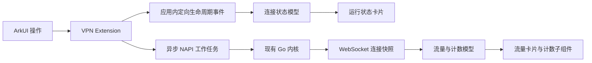

# 启停状态推送与启动性能改造

日期：2026-10-28。分支：dev。

本文记录此阶段的实现和构建。2026-10-29 的后台任务、事件丢失兜底和更快的停止确认，以及当前安装包见 [后台稳定性与关闭延迟](background-stability.md)。

用户反馈启停时运行状态更新不及时、启动较慢，并授权自主选择技术方案。本轮采用 ArkUI + 后台 NAPI + Go 内核，增加生命周期事件与 WebSocket 数据推送。没有引入 Rust、仓颉或更换已验证可联网的 Go 内核。

## 1 四项建议的处理结果

| 建议 | 本轮结果 | 理由与边界 |
| --- | --- | --- |
| UI 状态粒度拆分 | 已实施 | 连接状态、流量图和运行计数分为独立组件；高频数据不再写入整个页面的 State 汇总和刷新 token |
| 推送替代首页 HTTP 轮询 | 已实施 | VPN 扩展推送生命周期；Mihomo 的连接快照通过 WebSocket 推送，删除原首页定时 GET 逻辑 |
| Go 库编译裁剪 | 暂缓 | 仓库缺少与现有预编译库完全匹配的 Go 源码、适配补丁和可复现构建参数；当前打包已经执行符号剥离 |
| 内核自恢复 | 完成基础检测，后续单独建设 | 数据通道有限重连、失联后一次核对内核状态；暂不因数据通道异常自动重启 VPN |

语言本身不决定是否流畅。NAPI 是进程内原生调用接口，跨运行环境的控制和通知还需要 IPC 或系统事件；耗时调用放在工作线程中执行。

## 2 核对过的 FlClash 鸿蒙实现

研究了 [tljk/FlClash-ohos 的发布提交 017c08b](https://github.com/tljk/FlClash-ohos/tree/017c08b8f842fef37ffb3220605b2477380a6dc4)：

- [ServicePlugin.ets](https://github.com/tljk/FlClash-ohos/blob/017c08b8f842fef37ffb3220605b2477380a6dc4/ohos/entry/src/main/ets/plugins/ServicePlugin.ets) 通过 Flutter MethodChannel 接收操作并返回事件。
- [VpnExtAbility.ets](https://github.com/tljk/FlClash-ohos/blob/017c08b8f842fef37ffb3220605b2477380a6dc4/ohos/entry/src/main/ets/extensionAbility/VpnExtAbility.ets) 通过鸿蒙 RPC 提供服务，调用另一套 core 接口。
- 其内核桥接接口包括 invokeAction、setEventListener、startTUN，与当前预编译库的 MihomoStart / MihomoStartCore / MihomoStop 不同，不能直接替换桥接代码或二进制。

本项目借鉴事件与调用分离的结构，使用现有内核已提供的接口实现，不要求重新编译 Go。Mihomo 的 [connections 路由实现](https://github.com/MetaCubeX/mihomo/blob/Meta/hub/route/connections.go) 支持 WebSocket 升级、立即发送快照及按 interval 推送。

## 3 当前通信与界面结构



- [VpnRuntimeEvents.ets](../entry/src/main/ets/services/VpnRuntimeEvents.ets)：只订阅本应用发布的事件，只向本应用发布；携带 sessionId、递增序号、阶段、耗时和版本，不携带订阅、凭据或配置路径。校验数据并忽略旧序号、旧订阅回调，支持等待阶段结果与超时。
- [ControllerStreamService.ets](../entry/src/main/ets/services/ControllerStreamService.ets)：订阅 ws://127.0.0.1:9090/connections?interval=1000；停止时取消重连并忽略旧连接消息；连续失败最多重试三次。
- [HomeViewState.ets](../entry/src/main/ets/models/HomeViewState.ets) 与 [HomeRuntimeCards.ets](../entry/src/main/ets/components/HomeRuntimeCards.ets)：连接进度与高频数据分开。每个流量帧只更新数据模型；代理列表和策略组不会随着每个流量帧重新赋值。
- [Index.ets](../entry/src/main/ets/pages/Index.ets)：删除首页每秒 GET connections/configs、周期 GET version 和每三轮刷新代理的调度，移除强制刷新 token；仅在查看连接详情时构造连接行数据。

生命周期包括建立 VPN、启动内核、确认连接、已连接、断开中、已断开和错误。用户点击时先立即设置本地过渡阶段，后续由扩展事件确认。

这不等于删除全部 HTTP：订阅、节点操作、首次恢复现有运行状态、手动刷新和兼容性启动探测仍可使用请求。流量采样间隔仍为 1 秒；启停反馈不再依赖这个采样间隔。

## 4 启动路径的实际修改

1. startTun 也改为 Promise 和后台 NAPI 工作任务。界面和生命周期回调不再同步等待 Go。
2. 在排入后台任务时就复制 TUN FD，避免调用方关闭原 FD 后异步任务使用失效描述符。失败、取消和停止时处理 FD 归属。
3. TUN 与 controller-only 启动都通过 8MB 栈的专用 worker 调用 Go；保留已使用的栈适配方式。
4. getState 只返回缓存快照，不调用 Go 字符串 getter，也不获取 adapter 初始化锁。
5. 跳过没有运行本地核心时的无效 stopCore，去掉 UI 中固定 500ms 等待。
6. 去掉 dlopen 后固定 1 秒等待。对当前预编译库反汇编确认，MihomoStart 与 MihomoStartCore 均在进入 crosscall2 之前调用 _cgo_wait_runtime_init_done，因此继续由内核自己的初始化就绪屏障等待。
7. 出站模式提前写入运行 YAML，减少启动后额外同步模式的请求。
8. 内核确认可用后立即结束按钮加载；策略组同步、恢复节点与可达性检查在后台继续。旧会话或断开前的异步结果不能覆盖新状态。

反汇编证据保存在 artifacts/runtime-push-hap/go-start-entrypoints.txt。所检查源库 SHA256 为 0ed15ac3ea330c4324fe1ad2c8ba1f1e26f5d6b5ef03483a1c936f25d2ed218d。

删除固定等待不意味着每次启动都能净减少 1.5 秒：原来的等待可能与 Go 初始化重叠，网络、配置和内核实际工作仍需时间。若替换 Go 库，需要重新核对启动接口和就绪约定。

## 5 耗时与恢复行为

应用日志记录“连接耗时 · 阶段 · 毫秒”，VPN 扩展记录自身阶段耗时。阶段包括配置就绪、本地核心就绪、系统接收请求、VPN 可用和界面可操作，便于用真机区分配置处理、系统调用、Go 启动与附加检测。

数据通道断开会有限重连；超过限制后只进行一次内核状态核对。内核仍可访问时保留 VPN 连接，提示实时数据暂不可用。没有实现无上限重连，也没有自动重启内核或替用户重新连接 VPN。

后续内核自恢复需要单独确认进程退出、系统销毁、网络变化和手动断开，再设计退避、次数上限及恢复策略。

## 6 验证范围

- [runtime-push.test.mjs](../tests/runtime-push.test.mjs)：实际事件与数据通道服务、实际状态模型及页面方法。覆盖定向发布/订阅约束、数据校验、就绪结果缓存、过期消息、取消订阅、有限重连、非阻塞附加检查、阶段即时设置、流量帧和迟到的就绪确认。
- [core-startup-native.test.mjs](../tests/core-startup-native.test.mjs)：编译实际 NAPI 代码，覆盖启停返回 Promise、JS 心跳、正常与启停中的缓存状态、TUN FD 生命周期和错误恢复。
- 原有 native adapter、异步桥接、断开、UI 工作流、订阅 21 项与 app-flow 回归。
- HarmonyOS 编译、签名和 ARM64 HAP 打包检查。

本机测试不加载真实鸿蒙 Go 库，不能代替真机性能测量。当前环境无法直接访问设备 HDC server，尚未得到新版手机启动耗时和帧时间对比。

用 DevEco Run 覆盖安装，从手机桌面打开。核对点击连接/断开时状态卡片立即进入相应阶段、就绪后按钮恢复、上传下载持续更新；再查看工具里的阶段耗时记录。原生 Debug 会影响 Go 信号与运行时间，性能复测应使用普通 Run。

## 7 本轮安装包

HarmonyOS debug 编译和签名通过；新增推送、原生启停、断开、UI 工作流、异步桥接、adapter 和订阅回归均通过。ARM64 HAP 内容、依赖与内核打包检查通过，证据位于 artifacts/runtime-push-hap/。x86_64 仍使用原项目的 fake adapter。

安装包：[entry-default-signed.hap](../entry/build/default/outputs/default/entry-default-signed.hap)。本次 SHA256：

```text
195ba7142a7082b731e3c70e1da3db62b5e3f22968dfe14e72597d255b68289a
```

重新构建或签名后哈希可能变化。用户签名配置与 .clangd 修改保留，现有订阅存储方式不变。
